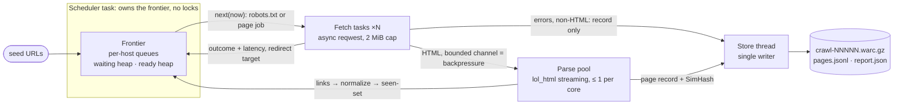
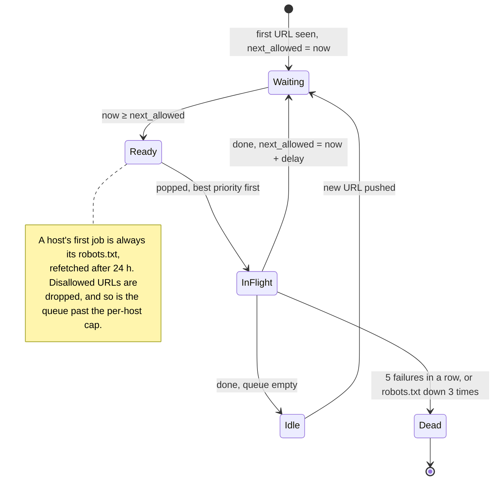
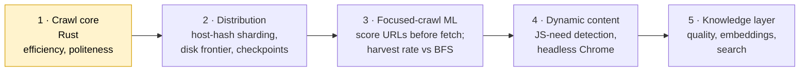
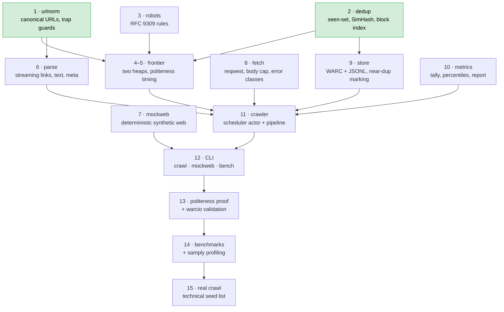

# McCrawl

A high-performance web crawler: an async Rust crawl engine, with Python ML for crawl prioritization and search on top.

It focuses on the hard parts of crawling at scale:
- **Throughput:** thousands of hosts in flight on one machine.
- **Politeness:** per-host rate limits that adapt to how each server responds, and RFC 9309 robots.txt.
- **Dedup:** canonical URLs plus SimHash near-duplicate detection.
- **Archival output:** standard WARC files.

> **Status:** sub-project 1 (crawl core) is in progress, 2 of 15 tasks done. The full design is in [`docs/superpowers/specs/2026-11-18-crawl-core-design.md`](docs/superpowers/specs/2026-11-18-crawl-core-design.md) and the task-by-task plan in [`docs/superpowers/plans/2026-11-18-crawl-core.md`](docs/superpowers/plans/2026-11-18-crawl-core.md).

## What the crawler does

### Pipeline

A single scheduler task owns the frontier, so the frontier needs no locks. The scheduler hands jobs to async fetch tasks. HTML goes to a CPU-bound parse pool; every record goes to a single store writer. Links found during parsing flow back into the frontier.



### Politeness: the life of a host in the frontier

Every host is in exactly one place at a time:
- the **waiting heap** (sorted by when it may next be contacted);
- the **ready heap** (sorted by the priority of its best queued URL);
- **in flight** (at most one request per host).

The waiting heap decides *when* a host may be contacted, and the ready heap decides *which* allowed host is worth the most. This is a deterministic variant of Mercator's front/back queues.



The delay after each response adapts to the server:

```
delay = max(robots Crawl-delay, min_delay = 1 s, 5 × response_time) × backoff

429 / 503    → backoff × 2 (capped at 10 min), Retry-After always honored
success      → backoff ÷ 2 (down to 1)
robots.txt   → 2xx: obey · 4xx: allow all · 5xx/unreachable: fetch nothing, retry in 60 s, then 120 s
```

### Dedup and trap defenses

| Layer | How |
|---|---|
| Same URL spelled differently | WHATWG parse, lowercase host, drop default port, fragment and empty query (`urlnorm`) |
| Crawler traps | URL > 2048 chars, or any path segment repeated > 3 times (`/a/b/a/b/a/b/a/`); ≤ 5 redirect hops; per-host page cap |
| Same URL twice | 64-bit xxh3 seen-set |
| Identical body | xxh3 body hash |
| Near-identical body | 64-bit SimHash over word 3-shingles; Hamming distance ≤ 3, found via a 4 × 16-bit block index (Manku et al., 2007), not a linear scan |

## The plan

### Roadmap

Each sub-project gets its own spec → plan → build cycle.



### Sub-project 1 build order

Each box is one task, built test-first. An arrow `A → B` means B uses A. Green means done.



## Layout

```
src/        the crate: one module per box above (lib.rs declares them, main.rs is the CLI)
tests/      one test file per module, against the public API
docs/       design spec and implementation plan
```

## Running

```sh
cargo test                 # everything
cargo test --test dedup    # one module
```

The `crawl`, `mockweb` and `bench` commands arrive with Task 12.
