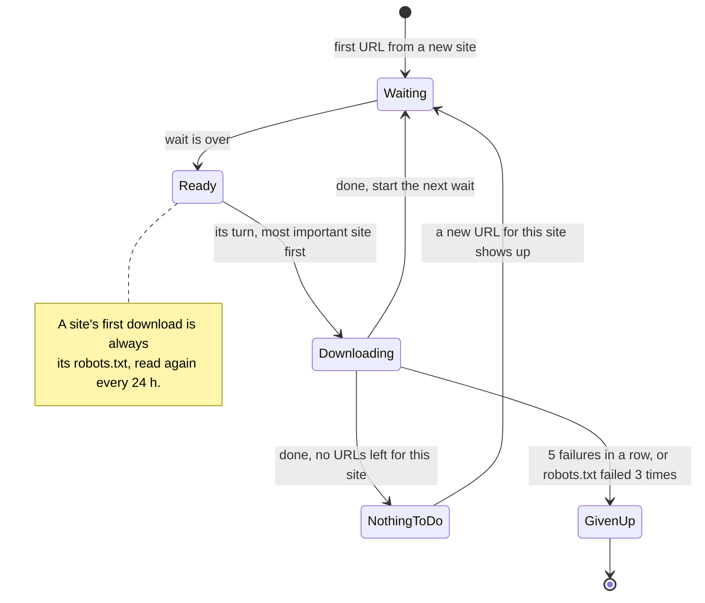
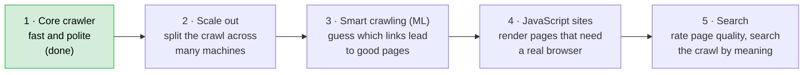
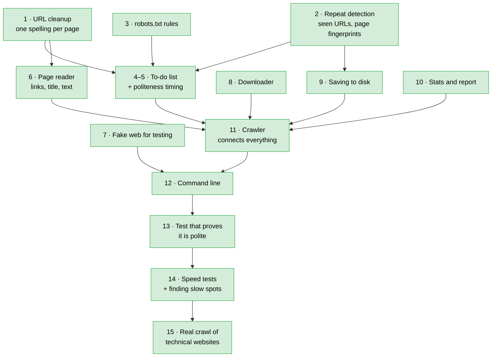

# McCrawl

McCrawl is a **web crawler**: a program that starts from a few web pages, follows their links, and downloads pages from across the web. The crawler is written in Rust, for speed. Later parts add Python machine learning (ML), first to choose which pages are worth downloading first, then to search what was downloaded.

What it is built to do well:
- **Fast:** download from thousands of websites at the same time, on one laptop.
- **Polite:** never overload a website. It waits between requests to the same site, slows down when a site is slow or says "too many requests", and follows each site's `robots.txt` rules.
- **No repeats:** skip URLs it has already seen, and spot pages that are copies or near-copies of each other.
- **Standard output:** save pages as WARC files, the format web archives use.

> **Status:** part 1 (the core crawler) is done: all 15 steps, 178 tests. Results are [below](#results). The full design is in [`docs/superpowers/specs/2026-11-18-crawl-core-design.md`](docs/superpowers/specs/2026-11-18-crawl-core-design.md), and the step-by-step plan is in [`docs/superpowers/plans/2026-11-18-crawl-core.md`](docs/superpowers/plans/2026-11-18-crawl-core.md).

## How it works

### The big picture


In words:
1. The scheduler picks the next URL that is allowed to be downloaded right now.
2. A downloader fetches it. Many downloads run at the same time.
3. HTML pages go to a reader, which pulls out the links, title and text.
4. New links go back onto the to-do list, and everything gets saved to disk.
5. This repeats until the page budget is used up or there is nothing left to do.

If the readers fall behind, the downloaders wait, so memory never fills up with unread pages.

### Being polite to websites

The rules for each website:
- **One at a time:** at most one download at a time from any website.
- **Wait between downloads.** The wait is the longest of these three:
  - 1 second;
  - 5 × how long the site took to answer (a slow answer usually means a busy server);
  - the delay the site asks for in its `robots.txt`.
- **Back off when told to:**
  - "Too many requests" (HTTP 429) or "busy" (503) doubles the wait, up to 10 minutes.
  - Each successful download halves it again.
  - If the site says exactly how long to wait (`Retry-After`), wait that long.
- **Read `robots.txt` first,** and never download pages it forbids.
  - If `robots.txt` fails to load because the site is erroring, download nothing from that site.
  - Try `robots.txt` again after 1 minute, then after 2.
  - After 3 failures, give up on the site.
- **Know when to stop:** give up on a site after 5 failures in a row, and stop at a page limit per site.

Behind the scenes, every website is always in exactly one of these states:



Internally there are two lines:
- **Waiting line:** sites sorted by "when is this site allowed again?".
- **Ready line:** sites sorted by "how important is this site's best URL?".

The first line keeps the crawler polite and the second keeps it useful. Both stay fast with millions of sites: picking the next one takes a few dozen steps, not one step per site.

### Avoiding repeats and traps

| Problem | What McCrawl does |
|---|---|
| One page, many spellings (`HTTPS://Example.com:443/x#top` and `https://example.com/x`) | Rewrites every URL into one standard form |
| Endless URLs (links that loop forever, like `/a/b/a/b/a/b/...`) | Skips URLs over 2048 characters or with a path part repeated more than 3 times, follows at most 5 redirects, and limits pages per site |
| The same URL found again | Remembers a short hash (an 8-byte code) of every URL seen |
| An exact copy of a page | Compares a hash of the page content |
| A near copy (same article, different ads) | Gives each page a text fingerprint (SimHash) so similar pages get similar fingerprints, then finds close matches with a lookup table instead of checking every page |

## Results

Measured on one laptop (32 cores, under WSL), never estimated.

### Speed, on a fake web

`mccrawl bench` crawls a fake web served on the same machine: 10,000 websites, pages of about 30 KB, 200,000 pages a run.
- **Raw mode:** no waiting and instant answers, so it measures the crawler's own top speed.
- **Polite mode:** the real rules (1 second between requests to a site, longer if it asks) and answers that take 20–200 ms. One site in ten asks for a 2-second wait and one in ten has its robots.txt down (so gets nothing), so the most politeness allows is 8,500 pages a second.

| Download slots | Raw, pages/s | Polite, pages/s | Polite, share of the most allowed |
|---:|---:|---:|---:|
| 64 | 9,390 | 542 | 6.4% |
| 256 | 10,219 | 2,162 | 25.4% |
| 1,024 | 9,276 | 6,667 | 78.4% |

- **Few slots: a simple limit.** A slot handles one page at a time and an answer takes about 0.11 s, so 64 slots can't do more than 64 ÷ 0.11 ≈ 580 pages a second (Little's law). Measured: 542.
- **1,024 slots: politeness is the limit.** For 27 of the 30 seconds, a slot was free but no site was allowed yet. The rest of the gap is the rule itself: each site waits after its answer, not from when it was asked.

### What profiling found

CPU profiles (`perf`) of raw mode led to two fixes:

| Build | Raw pages/s (64 / 256 / 1,024 slots) | CPU seconds a run |
|---|---|---|
| Start | 1,021 / 1,014 / 1,038 | ~325 |
| 1. Compress pages in the readers, not the saver | 8,806 / 7,966 / 7,454 | ~650 |
| 2. A faster compression library | 10,262 / 8,128 / 10,072 | ~320 |

1. **The saver was the bottleneck.** One thread compressed every page into the web archive and ran at 100% while everything else idled, so speed was stuck near 1,000 pages a second whatever the slots. Each archived page is compressed on its own, so the 32 readers now do it in parallel. That made it 7–9× faster.
2. **Compression was then 68% of all CPU time.** Switching to the `zlib-rs` library halved the CPU per page.

What's left: the saver thread is the limit again in raw mode, mostly the time spent writing about 300 MB a second of files.

### A real crawl

The 163 sites in [`seeds/technical.txt`](seeds/technical.txt), 30,000 fetches, the default settings (512 slots, robots.txt obeyed), over a home connection:

| | |
|---|---|
| Time | 5 min 4 s |
| Answers | 25,198, about 83 a second |
| Pages saved | 17,860 HTML pages, in a 596 MB web archive that `warcio` reads cleanly |
| Websites | 33,406 found, pages fetched from 7,539; 157 of the 160 seed sites reached |
| Skipped because robots.txt said no | 2,795 URLs |
| Copies found | 425 exact, 1,136 near |
| Timeouts | 4,779, 16% of fetches |
| Peak memory, CPU | 540 MB, 97 s |

What it shows:
- **The network is the limit, not the computer.** It used 97 CPU seconds in 5 minutes.
- **Following every link drifts off topic.** Only 26% of the saved pages came from the seed sites. Choosing which links to follow first is part 3's job.
- **A bug it found:** the crawler kept connections open to reuse them for a site's next page. On the real web, reused connections often hung until the timeout. Side-by-side test crawls showed 15–22% timeouts with reuse and 5–7% without, while `curl` fetched the hung pages fine from the same machine. Now every fetch opens its own connection. Compared with the first real crawl, this one took 25% less time, gave up on 938 sites instead of 3,650, and used half the memory.
- **Still open:** 16% of fetches time out at 512 slots, rising as the crawl reaches more sites, though `curl` fetches those pages fine. Ruled out so far: DNS, HTTP/2, bandwidth, the router, shared hosting and the sites themselves. Next is timing each stage of a fetch inside the crawler.

## Using it

Build once, with `cargo build --release`; the program is `mccrawl`.

```sh
# Crawl real sites. --contact goes into the User-Agent so site owners can reach you.
mccrawl crawl --seeds seeds/technical.txt --budget 30000 --contact https://example.com/about-my-crawler

# Serve the fake web, to point a crawl at it (prints a curl example)
mccrawl mockweb --hosts 10000 --port 8080

# Speed tests against the fake web
mccrawl bench --mode raw --concurrency 64,256,1024
mccrawl bench --mode polite

# Check a crawl's web archive with an independent library
uv run --with warcio python tests/warc_check.py ~/mccrawl-data/run-<id>
```

A crawl writes `crawl-NNNNN.warc.gz` (the pages), `pages.jsonl` (one row per fetch: title, text, links, fingerprints) and `report.json` (the numbers above) to `~/mccrawl-data/` unless `--out` says otherwise. Ctrl-C stops it gracefully and still saves everything; a second Ctrl-C quits at once. `--theme mocha` switches the colors.

## The plan

### Five parts

Each part gets its own design, plan and build.



### Part 1, step by step

Each box is one step, and its tests are written before its code. An arrow from A to B means B is built on A. Green means done.



## Folders

```
src/        the crawler's code, one file per box above
tests/      the tests, one file per code file
seeds/      the starting sites for the real crawl
docs/       the full design and the step-by-step plan
```

## Running the tests

```sh
cargo test                     # run every test
cargo test --test politeness   # one file: here, the proof that it stays polite
```
