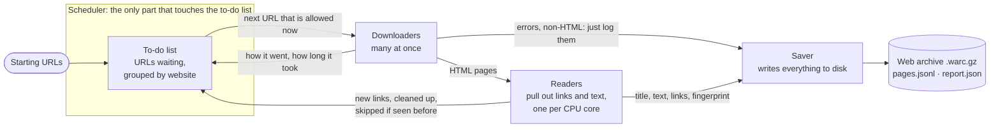
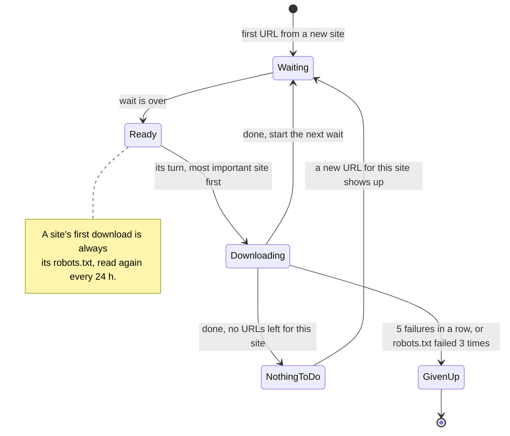
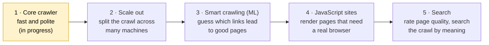
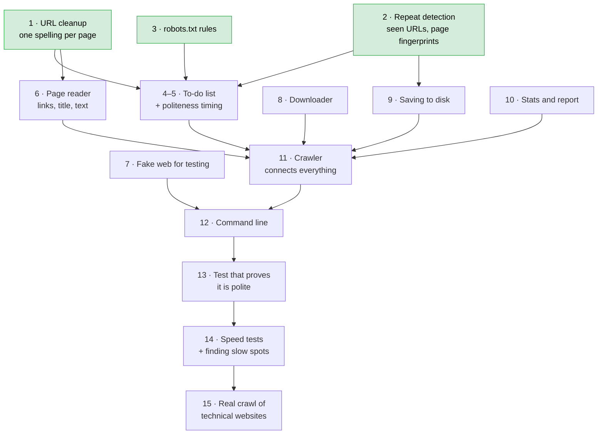

# McCrawl

McCrawl is a **web crawler**: a program that starts from a few web pages, follows their links, and downloads pages from across the web. The crawler is written in Rust, for speed. Later parts add Python machine learning (ML), first to choose which pages are worth downloading first, then to search what was downloaded.

What it is built to do well:
- **Fast:** download from thousands of websites at the same time, on one laptop.
- **Polite:** never overload a website. It waits between requests to the same site, slows down when a site is slow or says "too many requests", and follows each site's `robots.txt` rules.
- **No repeats:** skip URLs it has already seen, and spot pages that are copies or near-copies of each other.
- **Standard output:** save pages as WARC files, the format web archives use.

> **Status:** part 1 (the core crawler) is being built, and 3 of 15 steps are done. The full design is in [`docs/superpowers/specs/2026-11-18-crawl-core-design.md`](docs/superpowers/specs/2026-11-18-crawl-core-design.md), and the step-by-step plan is in [`docs/superpowers/plans/2026-11-18-crawl-core.md`](docs/superpowers/plans/2026-11-18-crawl-core.md).

## How it works

### The big picture



In words:
1. The scheduler picks the next URL that is allowed to be downloaded right now.
2. A downloader fetches it. Many downloads run at the same time.
3. HTML pages go to a reader, which pulls out the links, title and text.
4. New links go back onto the to-do list, and everything gets saved to disk.
5. This repeats until the page budget is used up or there is nothing left to do.

If the readers fall behind, the downloaders wait, so memory never fills up with unread pages.

### Being polite to websites

The rules for each website:
- **One at a time:** at most one download at a time from any website.
- **Wait between downloads.** The wait is the longest of these three:
  - 1 second;
  - 5 × how long the site took to answer (a slow answer usually means a busy server);
  - the delay the site asks for in its `robots.txt`.
- **Back off when told to:**
  - "Too many requests" (HTTP 429) or "busy" (503) doubles the wait, up to 10 minutes.
  - Each successful download halves it again.
  - If the site says exactly how long to wait (`Retry-After`), wait that long.
- **Read `robots.txt` first,** and never download pages it forbids.
  - If `robots.txt` fails to load because the site is erroring, download nothing from that site.
  - Try `robots.txt` again after 1 minute, then after 2.
  - After 3 failures, give up on the site.
- **Know when to stop:** give up on a site after 5 failures in a row, and stop at a page limit per site.

Behind the scenes, every website is always in exactly one of these states:



Internally there are two lines:
- **Waiting line:** sites sorted by "when is this site allowed again?".
- **Ready line:** sites sorted by "how important is this site's best URL?".

The first line keeps the crawler polite and the second keeps it useful. Both stay fast with millions of sites: picking the next one takes a few dozen steps, not one step per site.

### Avoiding repeats and traps

| Problem | What McCrawl does |
|---|---|
| One page, many spellings (`HTTPS://Example.com:443/x#top` and `https://example.com/x`) | Rewrites every URL into one standard form |
| Endless URLs (links that loop forever, like `/a/b/a/b/a/b/...`) | Skips URLs over 2048 characters or with a path part repeated more than 3 times, follows at most 5 redirects, and limits pages per site |
| The same URL found again | Remembers a short hash (an 8-byte code) of every URL seen |
| An exact copy of a page | Compares a hash of the page content |
| A near copy (same article, different ads) | Gives each page a text fingerprint (SimHash) so similar pages get similar fingerprints, then finds close matches with a lookup table instead of checking every page |

## The plan

### Five parts

Each part gets its own design, plan and build.



### Part 1, step by step

Each box is one step, and its tests are written before its code. An arrow from A to B means B is built on A. Green means done.



## Folders

```
src/        the crawler's code, one file per box above
tests/      the tests, one file per code file
docs/       the full design and the step-by-step plan
```

## Running the tests

```sh
cargo test                 # run every test
cargo test --test dedup    # run one file's tests
```

Commands to actually crawl (`crawl`, `mockweb`, `bench`) come in step 12.
